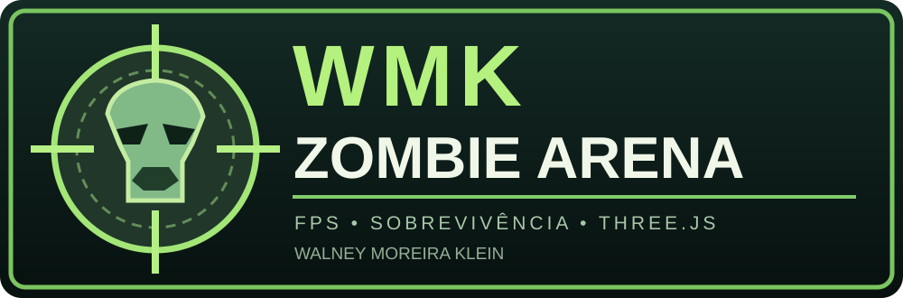

> **v2.0.0-RC4 — PACOTE DE CONSOLIDAÇÃO (TESTES):** FPS/editores v2.0-RC3 com links para Cidade Viva, Loja W$, Backup JSON e ganhos W$ por inimigo eliminado. Para publicar, rode `PUBLICAR-GITHUB.bat` com Git instalado, pois este ambiente não conseguiu enviar os arquivos locais completos diretamente ao GitHub. O publicador mescla com a `main`, preservando os módulos da Cidade Viva e da loja que já estão no fork. Não confundir GitHub atualizado com teste no navegador concluído.

> **v2.0.0-rc1 — CANDIDATA LOCAL:** Menu e finalização separados, captura de mouse com erro tratado e botões Zombie/Skin Studio. Ainda não publicada no GitHub Pages. [Plano de validação](manuais/validacao-v2.html).

## v1.9.5 — Bots e zumbis personalizados na Operação Bomba

Selecione 3, 5 ou 7 aliados e inimigos, e escolha defensor tático, tipo de zumbi específico criado no Zombie Studio ou uma mistura de todos. A vida, velocidade e dano de zumbis personalizados são preservados. Consulte [Manual de inimigos da Operação Bomba](manuais/operacao-bomba-inimigos.html). Esta versão está no ZIP local e **não foi publicada automaticamente no GitHub Pages**.

> **v1.9.4 — Academia FPS:** treino com número finito de alvos, sem renascimento automático. Ao eliminar todos, abre relatório com precisão, disparos, headshots, tempo, ritmo e botões Reiniciar/Voltar ao menu. [Manual](manuais/academia-resultado-final.html).

## v1.9.3 — Equipes, miras e avatares (protótipo offline)

- Operação Bomba: escolher independentemente 3, 5 ou 7 bots aliados e inimigos; o jogador é um atacante extra.
- Miras por arma: formato, cor, tamanho, espessura e preferência dinâmica (a preferência visual está salva; a interação precisa com dispersão requer calibração adicional).
- Avatar Studio: criar perfis de cores de personagem 3D geométrico, importar/exportar JSON e visualizar no modo TPS.
- Documentação: `manuais/fps-classicos-modernizacao.html` e `manuais/bots-miras-avatares.html`.
- Não inclui multiplayer real, editor de vértices, rigs, mapas copiados nem personagens comerciais.

> **v1.9.2 (prévia local):** pausa isolada por modo, menu principal separado, bots aliados e defensores no modo bomba, temporizador de tiro corrigido; ainda não há multiplayer em rede. Fonte completo incluído.

> **v1.9.1 (local):** Menu de pausa independente para Sobrevivência, Academia e Operação Bomba; bots 5×5 offline; manual de multiplayer. O jogo online real ainda precisa de servidor.

> **v1.9.0 — correção dos modos:** seleção por cartões independentes na tela inicial; Academia FPS agora inicializa com qualquer distância, inclusive mistas (5, 10, 20, 30 m). Corrigido `TypeError: distances is not iterable`.

> **v1.8.9 — corrigido treinamento e alternância FPS/TPS:** escolha Academia de mira, configure distância/exercício e clique em **INICIAR TREINAMENTO**. Durante o jogo, pressione **P** para alternar primeira e terceira pessoa; role o mouse na terceira pessoa para aproximar/afastar. A visualização TPS é experimental, com personagem geométrico provisório e disparo calculado da posição FPS.

> **Correção v1.8.8:** seletor de modo altera o botão para INICIAR TREINAMENTO, treinamento abre com as opções escolhidas, painel de desempenho e respawn de alvos tolerante a pausa. Esta versão ZIP não substitui a publicada no GitHub até ser enviada à branch de implantação.

> **v1.8.6 — Zombie Studio:** novo editor para criar/duplicar zumbis, configurar boss e atribuir vários tipos aos pontos de spawn de cada mapa. A publicação no GitHub não é automática.

> **v1.8.4 — Workspace 3D:** Arsenal Studio com canvas amplo, painéis móveis/redimensionáveis, layouts nomeados, gizmos, snap e navegação inspirada no Blender. Editor de mapas com ajustes de painéis, salvamento de alturas e voo livre. Veja [manual HTML](manuais/workspace-3d.html).

# WMK Zombie Arena — v1.8.3 (Arsenal Studio + bazuca)

Esta versão adiciona um editor local de armas comunitárias, com exemplo de bazuca fictícia, projétil 3D, dano em área e cadastro automático no menu B → 9. **O modelo GLB precisa ser colocado em assets/models/ e publicado junto; somente o JSON não carrega o modelo.**

Inicie com Live Server no VS Code, abra `arsenal.html` para editar, clique Salvar no jogo e recarregue `index.html`. Os dados ficam no localStorage da mesma origem. A versão online do GitHub Pages só mudará após publicação desses arquivos.

Leia [Manual Arsenal Studio](manuais/arsenal-studio.html) para aprender a editar parâmetros, importar GLB do Blender e testar a arma. Créditos: Walney Moreira Klein — walneyk@hotmail.com.

---

> **v1.8.2 — Áudio e documentação para comunidade:** sons procedurais para armas, recarga, zumbis, dano, granadas e zoom; controle de volume; arquivos de áudio próprios opcionais. **Multiplayer 5x5 permanece planejado e NÃO está jogável.** Consulte [jogador (áudio)](manuais/usuario-audio.html), [armas e áudio](manuais/audio-armas.html), [multiplayer](manuais/multiplayer.html) e [contribuição](manuais/contribuir.html).

> **v1.8.0 — Atualização incremental:** Editor com painel de três colunas, atalhos semelhantes ao Blender, snap, layouts nomeados, kits rápidos, 4 novos mapas oficiais, granada HE e fumaça visual. Veja [manual do editor](manuais/editor-avancado-v180.html), [mecânicas](manuais/mecanicas-v180.html) e [pesquisa](manuais/pesquisa-fps-v180.html). O multiplayer, física de andares e obstrução de visão pela fumaça ainda não estão implementados.

> **v1.7.0 — pacote local:** arena Fábrica Horizonte, luneta AWP, editor com modelos GLB e prefabs. É necessário publicar a versão completa para atualizar o GitHub Pages.

<p align="center"></p>

# WMK Zombie Arena

**FPS 3D de sobrevivência contra zumbis, desenvolvido com HTML, CSS, JavaScript e Three.js.** Projeto autoral e educacional, inspirado em mecânicas genéricas de FPS táticos e sobrevivência, sem utilizar marcas, mapas ou recursos protegidos de outros jogos.

**Versão do pacote:** 1.8.1 · **Áudio e documentação:** 1.8.1 · **Estado:** protótipo didático.

**Autor:** Walney Moreira Klein — [walneyk@hotmail.com](mailto:walneyk@hotmail.com)

## ▶ Como jogar

1. Abra a pasta no VS Code e execute **Live Server** no arquivo `index.html`.
2. Ou execute `py -m http.server 5500` e acesse `http://localhost:5500`.
3. Selecione um dos três mapas e inicie a partida. É necessária internet para carregar o Three.js via CDN.
4. Sobreviva às ondas de zumbis. Aperte **B** para consultar as armas.

> Não execute pelo protocolo `file://`: os módulos JavaScript podem ser bloqueados pelo navegador. A versão atual é local e single-player, sem multiplayer.

## 🎮 Controles

| Entrada | Ação |
| --- | --- |
| WASD | Movimentar |
| Mouse | Mirar |
| Clique esquerdo | Atirar (segurar para armas automáticas) |
| R | Recarregar |
| 1 a 5 | Trocar arma |
| B | Abrir painel de armas |
| Shift | Correr |
| C ou Ctrl | Agachar |
| Espaço | Pular |
| Esc | Pausar/liberar mouse |

## ✅ Recursos atuais

- Três arenas geométricas: **Pátio de Contêineres**, **Depósito** e **Ruas**.
- Sistema de ondas progressivas de zumbis, perseguição e ataque corpo a corpo.
- Cinco armas com dados independentes (`weapons.js`): pistola, SMG, rifle, escopeta e precisão.
- Munição por arma, recarga temporizada, cadência, dispersão, multiplicador por região atingida e tiro *hitscan*.
- HUD com vida, munição, ondas, inimigos restantes, pontos e precisão.

## 📁 Organização

```text
WMK-Zombie-Arena/
├── index.html                   # Interface HTML
├── style.css                    # Interface visual
├── game.js                      # Cena, física simplificada, IA, armas, loop
├── weapons.js                   # Dados das cinco armas
├── assets/
│   └── logo.svg                 # Logo autoral vetorial
├── manuais/
│   ├── usuario.md               # Guia completo para jogar
│   ├── desenvolvedor.md         # Arquitetura e estudos técnicos
│   └── mecanicas.md             # Descrição detalhada dos sistemas
├── roadmap.html                 # Evolução por versões
├── LICENSE                      # MIT
└── README.md
```

## 📚 Documentação em português

- [Manual do jogador](manuais/usuario.md)
- [Manual do desenvolvedor](manuais/desenvolvedor.md)
- [Mecânicas do jogo](manuais/mecanicas.md)
- [Plano de evolução](roadmap.html)

## 🧪 Primeira experiência

Em `weapons.js`, altere `WEAPONS.pistol.damage` de `28` para `50`, salve, atualize a página e compare o comportamento. Depois teste `cooldown`, `reload`, `spread` e `pellets`. **Os números são parâmetros fictícios de jogo, não dados balísticos reais.**

## ⚠ Limitações

Não há multiplayer, áudio, personagens com esqueleto/animações, GLB de armas ou zumbis, navmesh, física avançada, compra com economia nem gravação persistente. IA e colisão são simplificadas; zumbis podem ficar presos e determinados obstáculos não podem ser escalados. Ver [roadmap](roadmap.html).

## ⚖ Licença

Código e documentação autorais distribuídos sob **[MIT](LICENSE)**. Bibliotecas e conteúdos de terceiros mantêm suas próprias licenças. A marca e logotipo são criados para o projeto, e a MIT não concede, por si só, direitos sobre marcas de terceiros.

## Editor de mapas 3D (v1.4.0)

Abra [editor.html](editor.html) para construir mapas com paredes, caixas, contêineres, construções, pontos de spawn e início do jogador. Movimente, gire e escale objetos; edite propriedades; arraste os painéis e salve JSON. O botão **Testar no jogo** abre o FPS no mapa personalizado. Consulte o [Manual do editor](manuais/editor-mapas.md).

**Importante:** armazenamento local do navegador é um recurso de teste; exporte seu JSON para backup. Mapas personalizados utilizam colisão 2D aproximada.


## Correção v1.4.1 — persistência do editor

- O editor salva automaticamente rascunhos no armazenamento local após alterações.
- Exportar JSON também cria uma cópia no navegador; não deveria recarregar a página.
- No reinício ou refresh, o último rascunho é recuperado.
- O botão **Testar no jogo** somente navega após salvar com sucesso.
- Para backup entre computadores/navegadores, utilize **Exportar JSON** e depois **Importar JSON**.
- Atenção: dados do navegador podem ser apagados pelo usuário, modo anônimo ou limpeza de site; o JSON baixado é o backup permanente.

## Arsenal clássico e skins (v1.6.0)

- **B** abre a compra: **1** pistolas, **2** escopetas, **3** submetralhadoras, **4** rifles, **5** metralhadoras, **6** munição principal, **7** munição secundária, **8** equipamentos (planejados).
- Dentro de uma categoria, use **1–9** para escolher a arma. **Backspace** retorna; **Esc** fecha; clique também funciona.
- Fora do menu: **1** arma principal, **2** pistola e **3** faca. **R** recarrega.
- Cada arma tem estatísticas próprias, categoria e preço *indicativo*. Compra gratuita em todos os modos desta versão; economia competitiva ainda não foi implementada.
- Seis skins por arma, selecionáveis após equipar; cores 3D procedurais e escolhas salvas no `localStorage`. Não são texturas PBR nem skins proprietárias.
- Parâmetros editáveis em `weapons.js`. Referência histórica de categorias do CS 1.6 no documento HTML de mecânicas.


## v1.6.0 — Correção da tela inicial

Menu de entrada reestruturado para telas desktop e resoluções menores: configuração à esquerda, controles à direita, ação principal fixa na parte inferior, documentação recolhível, sem alteração de IDs ou lógica do FPS.


## Publicação web — v1.6.0

**GitHub Pages:** https://walneynf.github.io/WMK-Zombie-Arena/  
**Marketplace:** [marketplace.html](marketplace.html) (catálogo estático em `mapas/index.json`)  
**Manual:** [Publicar no GitHub Pages](manuais/publicar-pages.html)

A publicação requer **todos os arquivos na raiz do repositório**, não somente README e LICENSE. Existe workflow em `.github/workflows/pages.yml`, com validação de presença de arquivos. No GitHub em **Settings → Pages**, selecione **GitHub Actions**.

### Versão 1.6.0
- Catálogo visual de mapas em cards com busca, filtros e download JSON.
- Abertura de mapas diretamente na arena via navegador, sem servidor extra.
- Publicação automatizada do Pages com validação básica de estrutura.
- Manual HTML específico para publicação web.

### Próximas versões
- **1.7:** gerar miniatura de mapa no editor, importar/exportar pacotes comunitários.
- **1.8:** editor modular de salas/andares, spawns por modo e navegação dos zumbis.
- **1.9:** envio de mapas via GitHub pull requests, revisões e catálogo atualizado por Actions.

### Publicar rapidamente pelo Windows

Extraia o pacote e execute `PUBLICAR-GITHUB.bat` na pasta do projeto. Ele **clona o repositório público**, copia os arquivos em uma pasta temporária, cria um commit e faz `git push origin main` usando a autenticação do Git instalada no Windows. Antes de executar, revise o script e confirme que você tem permissão para enviar arquivos. Ele não apaga arquivos existentes no repositório, mas pode sobrescrever arquivos de mesmo nome. Se houver alterações feitas por outras pessoas, revise antes de publicar. Depois configure **Settings → Pages → GitHub Actions**. O script não guarda senhas.


## Novidades da v1.7.0
- Novo mapa `mapas/fabrica-horizonte.json` no catálogo.
- Luneta de AWP com zoom duplo (clique direito), saída com V.
- Biblioteca ampliada do editor (pisos, vigas, tubulação, máquinas, tanques etc).
- Importação e prévia de GLB; arquivo deve ser copiado para `assets/models/`.
- Prefabs simples por objeto com exportação/importação JSON.
- Documentos HTML: `manuais/blender-prefabs.html` e `manuais/referencia-awp.html`.

- AWP WMK inclui modelo 3D original em `assets/models/wmk-precision-awp.glb` (visualização em primeira pessoa).


## Zombie Studio v1.8.6
Abra `zombie-studio.html` para criar e duplicar tipos de zumbis com atributos, cor e caminho GLB. No `editor.html`, clique no spawn e selecione vários tipos, quantidade relativa, peso e onda mínima. O jogo usa os dados locais da mesma origem. Veja `manuais/zombie-studio.html`.


## Academia de FPS v1.8.7
No modo **Academia de mira**, configure alvos perto (5/10 m), médios (20 m) ou longe (30 m), ou misture distâncias. Exercícios: precisão, alvos móveis, headshot e rajadas. Consulte [Manual da Academia](manuais/academia-fps.html).


## v1.9.6 — Mapas maiores e cenários de terror leve

- Terrenos 40/80/160/320 m exportados com `size` no JSON e respeitados pelo FPS.
- 22 objetos com visualização 3D autoral e edição de cores de fachada, telhado e detalhes.
- Kits: casa com quintal, cemitério, fazenda e rua de vila.
- 4 mapas originais e manual `manuais/mapas-grandes-terror.html`.
- Casas atuais são cenários exteriores sólidos; interiores transitáveis e navmesh são melhorias futuras.
- Para jogar via GitHub Pages é necessário publicar os arquivos e atualizar `mapas/index.json`.


## v2.0.0-RC2 — Correção do avatar

Ajustadas as posições da cabeça, pescoço e capacete no Avatar Studio **e no personagem TPS do jogo**. O pescoço agora encontra o topo do tronco sem intervalo. Nenhum JSON de cores existente precisa ser alterado. Para testar: abra `avatar-studio.html`, gire o modelo e verifique a junção; volte ao FPS, selecione terceira pessoa com `P` e confira o avatar.


## v2.0.0-RC4 — Zoom 3D consistente

Os quatro estúdios (Mapas, Arsenal, Zumbis e Avatar) possuem painel flutuante de zoom percentual, botões IN/OUT, Ajustar, distância em unidades e posição salva. [Manual do Zoom 3D](manuais/zoom-3d.html). A roda utiliza o OrbitControls e os limites variam com o tamanho do mapa.
