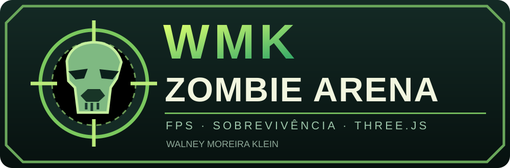

<p align="center"></p>

# WMK Zombie Arena

**FPS 3D de sobrevivência contra zumbis, desenvolvido com HTML, CSS, JavaScript e Three.js.** Projeto autoral e educacional, inspirado em mecânicas genéricas de FPS táticos e sobrevivência, sem utilizar marcas, mapas ou recursos protegidos de outros jogos.

**Versão do jogo:** 1.2.0 · **Versão da documentação e identidade visual:** 1.3.0 · **Estado:** protótipo didático.

**Autor:** Walney Moreira Klein — [walneyk@hotmail.com](mailto:walneyk@hotmail.com)

## ▶ Como jogar

1. Abra a pasta no VS Code e execute **Live Server** no arquivo `index.html`.
2. Ou execute `py -m http.server 5500` e acesse `http://localhost:5500`.
3. Selecione um dos três mapas e inicie a partida. É necessária internet para carregar o Three.js via CDN.
4. Sobreviva às ondas de zumbis. Aperte **B** para consultar as armas.

> Não execute pelo protocolo `file://`: os módulos JavaScript podem ser bloqueados pelo navegador. A versão atual é local e single-player, sem multiplayer.

## 🎮 Controles

| Entrada | Ação |
| --- | --- |
| WASD | Movimentar |
| Mouse | Mirar |
| Clique esquerdo | Atirar (segurar para armas automáticas) |
| R | Recarregar |
| 1 a 5 | Trocar arma |
| B | Abrir painel de armas |
| Shift | Correr |
| C ou Ctrl | Agachar |
| Espaço | Pular |
| Esc | Pausar/liberar mouse |

## ✅ Recursos atuais

- Três arenas geométricas: **Pátio de Contêineres**, **Depósito** e **Ruas**.
- Sistema de ondas progressivas de zumbis, perseguição e ataque corpo a corpo.
- Cinco armas com dados independentes (`weapons.js`): pistola, SMG, rifle, escopeta e precisão.
- Munição por arma, recarga temporizada, cadência, dispersão, multiplicador por região atingida e tiro *hitscan*.
- HUD com vida, munição, ondas, inimigos restantes, pontos e precisão.

## 📁 Organização

```text
WMK-Zombie-Arena/
├── index.html                   # Interface HTML
├── style.css                    # Interface visual
├── game.js                      # Cena, física simplificada, IA, armas, loop
├── weapons.js                   # Dados das cinco armas
├── assets/
│   └── logo.svg                 # Logo autoral vetorial
├── manuais/
│   ├── usuario.md               # Guia completo para jogar
│   ├── desenvolvedor.md         # Arquitetura e estudos técnicos
│   └── mecanicas.md             # Descrição detalhada dos sistemas
├── roadmap.html                 # Evolução por versões
├── LICENSE                      # MIT
└── README.md
```

## 📚 Documentação em português

- [Manual do jogador](manuais/usuario.md)
- [Manual do desenvolvedor](manuais/desenvolvedor.md)
- [Mecânicas do jogo](manuais/mecanicas.md)
- [Plano de evolução](roadmap.html)

## 🧪 Primeira experiência

Em `weapons.js`, altere `WEAPONS.pistol.damage` de `28` para `50`, salve, atualize a página e compare o comportamento. Depois teste `cooldown`, `reload`, `spread` e `pellets`. **Os números são parâmetros fictícios de jogo, não dados balísticos reais.**

## ⚠ Limitações

Não há multiplayer, áudio, personagens com esqueleto/animações, GLB de armas ou zumbis, navmesh, física avançada, compra com economia nem gravação persistente. IA e colisão são simplificadas; zumbis podem ficar presos e determinados obstáculos não podem ser escalados. Ver [roadmap](roadmap.html).

## ⚖ Licença

Código e documentação autorais distribuídos sob **[MIT](LICENSE)**. Bibliotecas e conteúdos de terceiros mantêm suas próprias licenças. A marca e logotipo são criados para o projeto, e a MIT não concede, por si só, direitos sobre marcas de terceiros.

## Editor de mapas 3D (v1.4.0)

Abra [editor.html](editor.html) para construir mapas com paredes, caixas, contêineres, construções, pontos de spawn e início do jogador. Movimente, gire e escale objetos; edite propriedades; arraste os painéis e salve JSON. O botão **Testar no jogo** abre o FPS no mapa personalizado. Consulte o [Manual do editor](manuais/editor-mapas.md).

**Importante:** armazenamento local do navegador é um recurso de teste; exporte seu JSON para backup. Mapas personalizados utilizam colisão 2D aproximada.


## Correção v1.4.1 — persistência do editor

- O editor salva automaticamente rascunhos no armazenamento local após alterações.
- Exportar JSON também cria uma cópia no navegador; não deveria recarregar a página.
- No reinício ou refresh, o último rascunho é recuperado.
- O botão **Testar no jogo** somente navega após salvar com sucesso.
- Para backup entre computadores/navegadores, utilize **Exportar JSON** e depois **Importar JSON**.
- Atenção: dados do navegador podem ser apagados pelo usuário, modo anônimo ou limpeza de site; o JSON baixado é o backup permanente.

## Arsenal clássico e skins (v1.5.1)

- **B** abre a compra: **1** pistolas, **2** escopetas, **3** submetralhadoras, **4** rifles, **5** metralhadoras, **6** munição principal, **7** munição secundária, **8** equipamentos (planejados).
- Dentro de uma categoria, use **1–9** para escolher a arma. **Backspace** retorna; **Esc** fecha; clique também funciona.
- Fora do menu: **1** arma principal, **2** pistola e **3** faca. **R** recarrega.
- Cada arma tem estatísticas próprias, categoria e preço *indicativo*. Compra gratuita em todos os modos desta versão; economia competitiva ainda não foi implementada.
- Seis skins por arma, selecionáveis após equipar; cores 3D procedurais e escolhas salvas no `localStorage`. Não são texturas PBR nem skins proprietárias.
- Parâmetros editáveis em `weapons.js`. Referência histórica de categorias do CS 1.6 no documento HTML de mecânicas.
